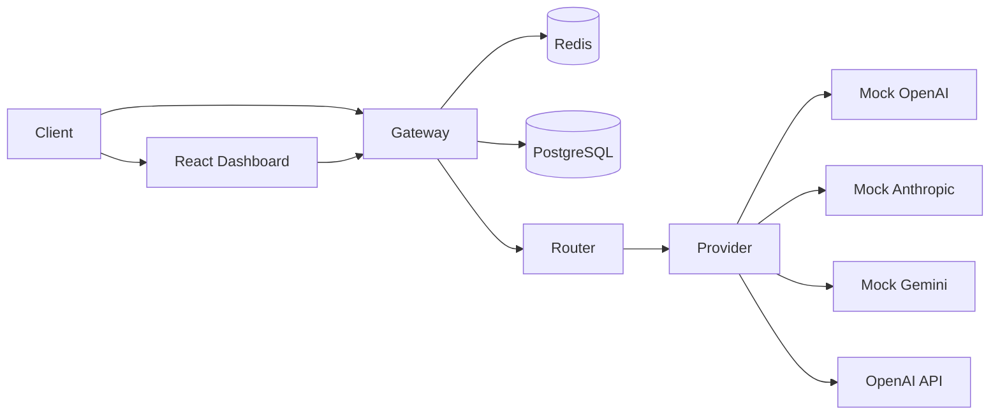
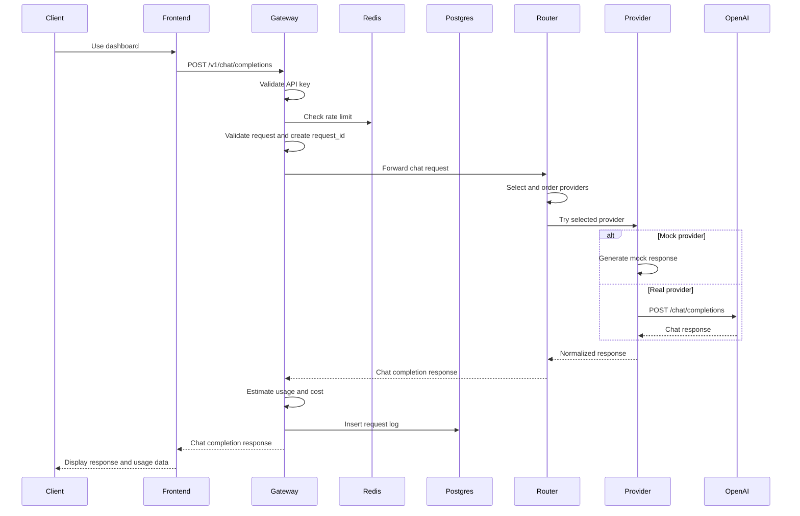
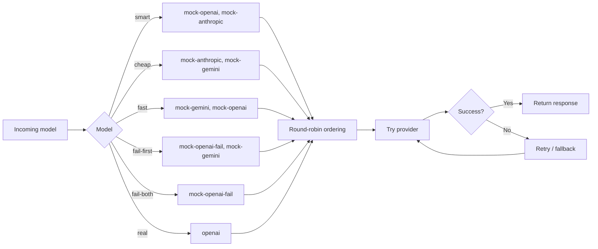

# Distributed LLM Gateway


A distributed LLM gateway built as a set of independent Go microservices with a React dashboard. It exposes an OpenAI-style chat completions API, authenticates client requests, rate limits by API key, routes requests across mock and real providers, retries failed providers, estimates token usage and cost, and logs request metadata to PostgreSQL.

## Architecture



## Project Structure

Each service is independently organized with its own API, business logic, validation, configuration, and Dockerfile.

```text
distributed-llm-gateway/
├── gateway-service/
├── router-service/
├── provider-service/
├── frontend/
├── docker-compose.yml
└── .env.example
```

## Services

### Gateway Service

Responsible for:

* Public OpenAI-compatible chat completions endpoint
* API key authentication
* Redis-backed rate limiting
* Request validation
* Request ID generation
* Forwarding requests to the router service
* PostgreSQL request logging
* Usage tracking
* Cost estimation
* Admin read endpoints for logs and usage summary

### Router Service

Responsible for:

* Model-to-provider selection
* Provider ordering
* In-memory round-robin load balancing per model
* Provider retry attempts
* Provider fallback
* Forwarding routed requests to the provider service

Supported models:

* smart
* cheap
* fast
* fail-first
* fail-both
* real

### Provider Service

Responsible for:

* Mock provider responses
* Simulated provider failure
* Real OpenAI API adapter
* OpenAI request construction
* OpenAI response normalization
* Provider-level error handling

Supported providers:

* mock-openai
* mock-anthropic
* mock-gemini
* mock-openai-fail
* openai

### Frontend Dashboard

Responsible for:

* Chat playground for testing gateway requests
* API key input
* Model selection
* Response preview
* Usage summary cards
* Request logs table
* Requests by model and provider breakdowns

---

## Tech Stack

### Backend

* Go
* Gin

### Frontend

* React
* TypeScript
* Vite
* Nginx

### Database

* PostgreSQL

### Cache / Rate Limiting

* Redis

### Provider Integration

* OpenAI Chat Completions API
* Mock providers

### Infrastructure

* Docker
* Docker Compose

### Architecture

* Microservices
* REST APIs
* API Gateway
* Provider routing
* Retry and fallback

---

## Features

* OpenAI-style `/v1/chat/completions` endpoint
* API key authentication with `Authorization: Bearer <api_key>`
* Redis-backed rate limiting
* Request validation
* Request ID propagation across services
* Model-based provider selection
* Round-robin load balancing per model
* Provider fallback and retry
* Mock provider support
* Real OpenAI provider adapter
* PostgreSQL request logging
* Prompt, completion, and total token estimation
* Input, output, and total cost estimation
* Admin logs endpoint
* Admin usage summary endpoint
* React dashboard for chat testing and usage visibility
* Docker Compose setup for the full system

---

## Request Flow



---

## Provider Routing

The router maps a client-facing model name to one or more providers.



The router keeps an in-memory counter per model. Each request rotates the provider order for that model, which gives simple round-robin load balancing for mock provider groups.

---

## Request Logging

The gateway writes one log row per client request.

Logged fields include:

* Request ID
* Model
* Provider
* Status code
* Duration
* Prompt tokens
* Completion tokens
* Total tokens
* Input cost
* Output cost
* Total cost
* Created timestamp

Failed requests are logged as well, with the provider left empty when no provider succeeds.

---

## Authentication

All gateway requests require:

```http
Authorization: Bearer <api_key>
```

The default local API key is:

```text
dev-api-key
```

For local development, this can be changed with:

```env
GATEWAY_API_KEY=<your_api_key>
```

---

## Getting Started

### 1. Prerequisites

* Docker
* Docker Compose
* Go 1.26+ if running services manually
* Node.js 22+ if running the frontend manually

### 2. Configure environment variables

Copy the example file:

```bash
cp .env.example .env
```

For mock providers, no OpenAI key is required.

For the real OpenAI provider, set this in the root `.env` file:

```env
OPENAI_API_KEY=<your_openai_api_key>
OPENAI_MODEL=gpt-4.1-nano
```

If `OPENAI_API_KEY` is not set and the `real` model is requested, the gateway currently returns an internal server error because the provider configuration error is not fully propagated through the router yet.

Docker Compose automatically reads `.env` from the project root. When `OPENAI_API_KEY` is set there, Compose passes it into `provider-service`.

You can also pass it inline:

```bash
OPENAI_API_KEY=<your_openai_api_key> docker compose up --build
```

On PowerShell:

```powershell
$env:OPENAI_API_KEY="<your_openai_api_key>"
docker compose up --build
```

### 3. Run everything with Docker Compose

```bash
docker compose up --build
```

Services will be available at:

```text
frontend          http://localhost:3000
gateway-service   http://localhost:8080
router-service    http://localhost:8081
provider-service  http://localhost:8082
postgres          localhost:5432
redis             localhost:6379
```

Browser traffic can use the dashboard at `http://localhost:3000`. API traffic should go through the gateway at `http://localhost:8080`.

### 4. Send a mock request

```bash
curl -X POST http://localhost:8080/v1/chat/completions \
  -H "Authorization: Bearer dev-api-key" \
  -H "Content-Type: application/json" \
  -d '{
    "model": "smart",
    "messages": [
      {
        "role": "user",
        "content": "Say hello from the mock provider."
      }
    ]
  }'
```

Example response:

```json
{
  "id": "uuid",
  "request_id": "uuid",
  "object": "chat.completion",
  "model": "smart",
  "provider": "mock-openai",
  "choices": [
    {
      "index": 0,
      "message": {
        "role": "assistant",
        "content": "mock response from openai"
      },
      "finish_reason": "stop"
    }
  ]
}
```

### 5. Send a real OpenAI request

Set `OPENAI_API_KEY` in the root `.env`, then run Docker Compose again.

```bash
curl -X POST http://localhost:8080/v1/chat/completions \
  -H "Authorization: Bearer dev-api-key" \
  -H "Content-Type: application/json" \
  -d '{
    "model": "real",
    "messages": [
      {
        "role": "user",
        "content": "Say hello in one short sentence."
      }
    ]
  }'
```

---

## API Endpoints

### Gateway Service

```http
POST /v1/chat/completions
GET  /admin/logs
GET  /admin/usage-summary
```

`POST /v1/chat/completions` sends a chat request through the gateway, router, and provider services.

Request body:

```json
{
  "model": "smart",
  "messages": [
    {
      "role": "user",
      "content": "Hello"
    }
  ]
}
```

`GET /admin/logs` returns the latest request logs from PostgreSQL.

Example response:

```json
[
  {
    "id": "uuid",
    "request_id": "uuid",
    "model": "smart",
    "provider": "mock-openai",
    "status_code": 200,
    "duration_ms": 24,
    "prompt_tokens": 8,
    "completion_tokens": 6,
    "total_tokens": 14,
    "input_cost_usd": 0.0000012,
    "output_cost_usd": 0.0000036,
    "total_cost_usd": 0.0000048,
    "created_at": "2026-10-14T01:19:03Z"
  }
]
```

`GET /admin/usage-summary` returns aggregated usage data for dashboard cards and charts.

Example response:

```json
{
  "total_requests": 10,
  "successful_requests": 9,
  "failed_requests": 1,
  "total_tokens": 152,
  "total_cost_usd": 0.000042,
  "average_duration_ms": 31.4,
  "requests_by_model": {
    "smart": 6,
    "cheap": 3,
    "real": 1
  },
  "requests_by_provider": {
    "mock-openai": 4,
    "mock-anthropic": 5,
    "openai": 1
  }
}
```

### Router Service

```http
POST /route/chat
```

Internal endpoint used by the gateway service.

### Provider Service

```http
POST /providers/chat
```

Internal endpoint used by the router service.

---

## Docker

Docker Compose starts:

* frontend
* gateway-service
* router-service
* provider-service
* PostgreSQL
* Redis

The frontend is served at:

```text
http://localhost:3000
```

Inside Docker, the frontend proxies `/api` requests to `gateway-service:8080`.

Stop the stack with:

```bash
docker compose down
```

Remove the PostgreSQL volume as well:

```bash
docker compose down -v
```

---

## Frontend Development

Run the dashboard locally with Vite:

```bash
cd frontend
npm install
npm run dev
```

The Vite dev server runs at:

```text
http://localhost:5173
```

During local development, frontend `/api` requests are proxied to `http://localhost:8080`.

---

## Security Features

* API key authentication at the gateway
* Redis-backed rate limiting per API key
* Input validation
* Request ID propagation
* No API keys committed to the repository
* `.env` files ignored by Git

**Note: Only `frontend` and `gateway-service` should be reachable outside your private network.** The router and provider services are internal services and currently trust requests from the gateway/router path. There is no mTLS, service-to-service authentication, or independent authorization between internal services yet.

---

## Future Improvements

* Health check endpoints
* Structured logging
* Prometheus metrics
* Distributed tracing
* Circuit breakers
* Provider-specific rate limits
* Persisted router state
* Provider health scoring
* More accurate token counting
* Streaming responses
* Kubernetes deployment
